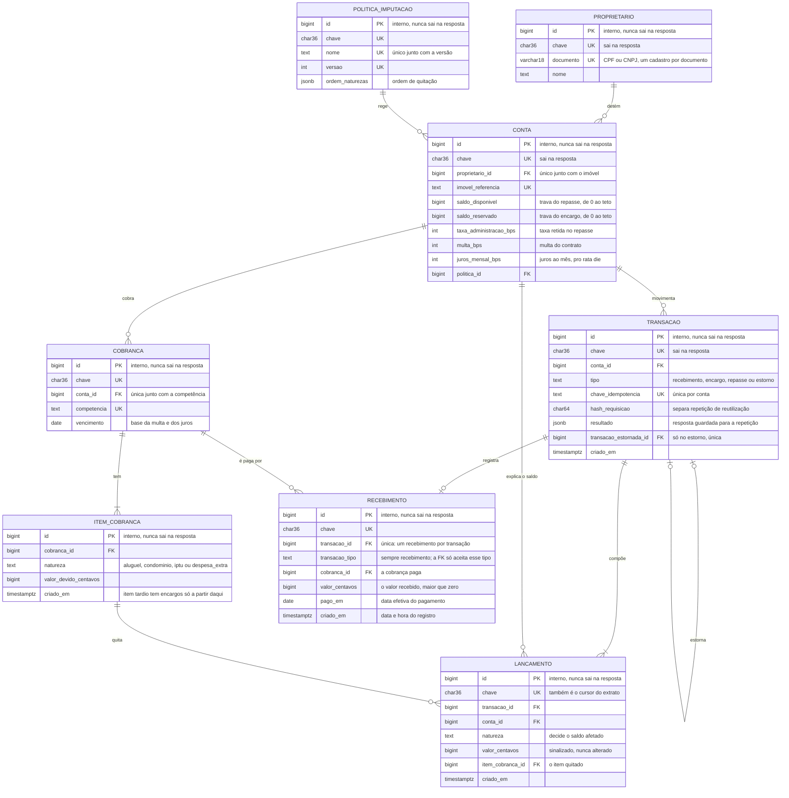

# RFC: ORCA, o livro-caixa interno da administradora

| | |
| --- | --- |
| **Time** | Emanuelly Dias · Julia Perri · Maya Giron |
| **Data** | 11/10/2026 |
| **Versão** | 2 |

O detalhe de cada decisão, com a alternativa descartada e o motivo, está no [documento de decisões](RFC.md).

## Contextualização

### Entendendo o problema

Uma administradora de imóveis recebe, numa conta bancária dela, dinheiro que é de vários proprietários. O inquilino paga aluguel, condomínio, IPTU e despesas extras num boleto só, e a administradora precisa saber, a cada momento, quanto de cada proprietário está guardado para o síndico e para a prefeitura, quanto pode ser repassado ao dono e quanto é a taxa dela. Quem usa o sistema é o operador da administradora: cadastra proprietários e contas por imóvel, lança a cobrança do mês, registra o recebimento, paga encargos, faz o repasse, estorna um lançamento errado e consulta saldo e extrato.

A garantia é sobre o registro do dinheiro: nenhum saldo fica negativo, o dinheiro do condomínio não é repassado ao proprietário, o dinheiro de um proprietário não paga obrigação de outro, o mesmo pagamento reenviado não entra duas vezes e o extrato soma exatamente os saldos. Se falhar, a administradora repassa dinheiro alheio, paga o condomínio com o aluguel de outro dono ou presta contas que não fecham, o que a Lei do Inquilinato (art. 22, VI) proíbe.

Fora do escopo desta entrega, por decisão de escopo (nível 1, só registro): a ORCA não executa PIX nem boleto, ou seja, não liquida o dinheiro no sistema bancário. O banco da administradora movimenta o dinheiro, a ORCA governa o registro e a posição financeira, e a administradora executa o pagamento. Também ficam fora a conciliação do extrato bancário, a copropriedade e as permissões por operador.

### Explicando a solução de forma macro

A ORCA é o núcleo de um banco dentro da administradora: contas, saldo, transações, tarifa e extrato. Cada proprietário tem uma conta por imóvel com dois saldos guardados na própria linha: o disponível, que pode ser repassado, e o reservado, que espera o condomínio e o IPTU. Todo movimento é uma transação com lançamentos imutáveis, e cada lançamento tem uma natureza (aluguel, condomínio, IPTU, despesa extra, multa, juros, taxa ou repasse); os saldos são sempre a soma dos lançamentos. O recebimento quita a cobrança do mês na ordem de uma política de imputação versionada (juros, multa, condomínio, IPTU, aluguel, despesa extra), e a taxa de administração é retida no repasse, só sobre o aluguel efetivamente quitado. As quatro operações que movem dinheiro (recebimento, pagamento de encargo, repasse e estorno) travam a linha da conta antes de ler qualquer saldo, conferem a `Idempotency-Key` com a conta travada e gravam lançamentos e saldos num único commit. Uma correção nunca apaga nada: é um estorno, com lançamentos de sinal invertido.

```text
Operador ──> API (FastAPI) ──> Controller: trava a conta, confere a idempotência e as regras
                                    │
                                    ▼
             PostgreSQL: transação + lançamentos + saldos, num único COMMIT
                         (UNIQUE e CHECK como rede de segurança)

Fora da ORCA: o banco da administradora recebe o boleto e paga síndico,
prefeitura e proprietário (PIX, TED); a ORCA diz de quem é cada valor.
```

O que foi considerado e descartado:

- **Saldo só como soma dos lançamentos, sem campo na conta:** descartado porque não elimina a trava (em READ COMMITTED, duas somas concorrentes leem o mesmo retrato e aprovam juntas) e faz cada débito custar o histórico inteiro. Ganharia se não houvesse débito concorrente, como num sistema só de consulta.
- **Uma conta única da administradora, com a posição de cada dono num relatório:** descartada porque nada impediria um repasse de consumir dinheiro de outro proprietário. Ganharia se a administradora tivesse um proprietário só.
- **Taxa de administração cobrada no recebimento:** descartada porque cobraria taxa sobre o dinheiro do síndico e da prefeitura, que só está de passagem. Ganharia se todo recebimento fosse só aluguel.
- **Rateio proporcional de um pagamento parcial entre as naturezas:** descartado porque deixaria condomínio e IPTU pagos pela metade, e nenhum credor aceita fração. Ganharia se os credores aceitassem pagamento parcial.

## Implementação

### Rotas

Todas as rotas exigem o header `INTERNAL-TOKEN` (sem ele, `403`) e respondem `400` (`QIT000001`) a corpo, query ou header fora do formato. As rotas de dinheiro exigem a `Idempotency-Key` e são idempotentes: a chave é única por conta no banco, e o hash da rota, da chave do caminho e do corpo separa a repetição (`200` com o resultado original, sem novo efeito) da chave reutilizada com outro pedido (`409`). Uma chave que não existe, fora do formato ou que não pertence a quem pede responde `404`, e não `403`, para não revelar que o recurso existe; o id interno do banco nunca sai numa resposta, só a chave UUID. Na Fase 1 há um só ator, o operador da administradora, identificado pelo `INTERNAL-TOKEN`, então o `404` cobre a chave inexistente e a chave de outro recurso.

Além das rotas de negócio abaixo, a API tem duas rotas operacionais: `GET /health_check/ready`, que diz se ela está pronta para tráfego consultando o banco, e `GET /metrics`, com as métricas de tráfego, erro e duração de cada rota. Toda operação que espera mais de 5 segundos pela trava da conta responde `503` com `Retry-After`, sem gravar nada. O jeito de pôr a API em produção está em [producao.md](../producao.md).

| Método | Caminho | O que faz | Entrada (campos que importam) | Saídas (status e quando) |
| --- | --- | --- | --- | --- |
| `POST` | `/proprietarios` | Cadastra o dono do imóvel | `documento` (CPF ou CNPJ, inclusive o alfanumérico, com máscara), `nome` | `201` com a chave; `422` dígito verificador errado; `409` documento já cadastrado |
| `POST` | `/contas` | Abre a conta do proprietário para um imóvel | `proprietario_chave`, `imovel_referencia`, `politica_imputacao_chave`, taxa, multa e juros em pontos-base | `201`; `404` proprietário ou política inexistente; `422` pontos-base fora de 0 a 10000; `409` conta já aberta para o imóvel |
| `POST` | `/contas/{chave}/cobrancas` | Registra o que o inquilino deve na competência | `competencia`, `vencimento`, `itens` (natureza e valor) | `201`; `404` conta; `422` data inexistente ou valor menor ou igual a zero; `409` competência já cobrada |
| `POST` | `/cobrancas/{chave}/itens` | Inclui uma despesa numa cobrança ainda não quitada | `natureza`, `valor_centavos` | `201`; `404` cobrança; `422` valor; `409` cobrança já quitada |
| `GET` | `/cobrancas/{chave}` | Mostra a posição da cobrança numa data, com multa e juros | query `data` (padrão: hoje em São Paulo) | `200`; `404` cobrança; `422` data inexistente ou anterior a um recebimento |
| `POST` | `/cobrancas/{chave}/recebimentos` | Registra o pagamento do inquilino e imputa pela política | `valor_centavos`, `pago_em`, `Idempotency-Key` | `201` com o rateio; `200` repetição; `409` chave com outro pedido; `404` cobrança; `422` valor menor ou igual a zero ou acima do devido na data, `pago_em` inexistente, no futuro ou antes de outro recebimento, saldo acima do teto |
| `POST` | `/contas/{chave}/encargos/pagamentos` | Paga condomínio ou IPTU com o reservado daquela natureza | `natureza`, `valor_centavos`, `Idempotency-Key` | `201`; `200` repetição; `409` reservado da natureza insuficiente ou chave reutilizada; `404` conta; `422` valor |
| `POST` | `/contas/{chave}/repasses` | Retém a taxa e registra o repasse do líquido ao dono | `valor_centavos` (bruto), `Idempotency-Key` | `201` com taxa e líquido; `200` repetição; `409` disponível insuficiente ou chave reutilizada; `404` conta; `422` valor menor ou igual a zero ou bruto menor ou igual à taxa pendente |
| `POST` | `/transacoes/{chave}/estornos` | Desfaz uma transação com lançamentos de sinal invertido | sem corpo, `Idempotency-Key` | `201`; `200` repetição; `404` transação; `409` já estornada, recebimento com outro posterior, saldo que não cobre o desfazer ou chave reutilizada; `422` saldo acima do teto |
| `GET` | `/contas/{chave}/saldo` | Devolve os dois saldos e a data do último lançamento | a chave no caminho | `200`; `404` conta |
| `GET` | `/contas/{chave}/devido` | Diz quanto o inquilino da conta deve numa data, somando as cobranças não quitadas, com multa, juros e os recebimentos de cada uma | query `data` (padrão: hoje em São Paulo) | `200`; `404` conta; `422` data inexistente ou anterior a um recebimento |
| `GET` | `/contas/{chave}/extrato` | Lista os lançamentos do mais recente para o mais antigo, sem partir uma transação | query `cursor`, `limite` (1 a 50), `natureza` | `200` com a página e o `proximo_cursor`; `400` limite, natureza ou cursor inválido; `404` conta |

### Banco de Dados (Somente diagrama)



### Fluxos

#### Recebimento: caminho feliz

1. O schema confere o corpo e a `Idempotency-Key`.
2. A API localiza a cobrança e trava a conta dela (`SELECT ... FOR UPDATE`); é a primeira leitura da conta.
3. Com a conta travada, procura a transação com a mesma chave na conta: não existe.
4. Relê os itens da cobrança, confere o valor e o `pago_em` e calcula o devido na data: o aberto dos itens, a multa sobre o que estava em aberto no vencimento e os juros por dia, por trechos entre os pagamentos.
5. Imputa o valor na ordem da política: juros, multa, condomínio, IPTU, aluguel, despesa extra.
6. Grava a transação, o recebimento (com a cobrança, o valor e a data do pagamento), um lançamento por parcela do rateio e os dois saldos (condomínio e IPTU no reservado, o resto no disponível), guarda a resposta e faz o COMMIT, que libera a trava.
7. Responde `201` com o rateio e o que ficou em aberto.

#### Recebimento: falha, reenvio simultâneo depois de um timeout

1. Duas requisições iguais, com a mesma `Idempotency-Key`, chegam ao mesmo tempo.
2. A primeira trava a conta; a segunda espera na trava, sem ler nada.
3. A primeira grava e faz o COMMIT; a segunda pega a trava, encontra a transação com a mesma chave e o mesmo hash e responde `200` com o resultado guardado, sem novo lançamento.
4. Se a chave vier com outro corpo, a resposta é `409`, e nada é gravado.

#### Repasse: caminho feliz

1. A API trava a conta e confere a `Idempotency-Key`.
2. Confere que o valor bruto cabe no disponível e calcula a taxa pendente: o aluguel já recebido vezes a taxa da conta, truncado, menos a taxa já retida, nunca negativa.
3. Grava o lançamento `taxa` (quando há taxa pendente) e o lançamento `repasse` com o líquido, baixa o disponível pelo valor bruto e faz o COMMIT.
4. Responde `201` com a taxa e o líquido; a transferência bancária é feita pela administradora, fora da ORCA.

#### Repasse: falha, dois repasses que juntos passam do disponível

1. O repasse A trava a conta e lê o disponível; o repasse B espera na trava.
2. A grava os lançamentos e o saldo e faz o COMMIT.
3. B pega a trava, lê o saldo já atualizado, a conferência falha, e B sofre ROLLBACK: `409`, sem lançamento órfão e sem saldo negativo.

#### Pagamento de encargo: caminho feliz

1. A API trava a conta e confere a `Idempotency-Key`.
2. Soma, com a conta travada, os lançamentos da natureza pedida (condomínio ou IPTU): é o reservado daquela natureza.
3. Grava um lançamento negativo dessa natureza, baixa o reservado e faz o COMMIT; responde `201`.

#### Pagamento de encargo: falha, o reservado total cobre, mas o da natureza não

1. A conta tem R$ 350,00 de condomínio e R$ 150,00 de IPTU reservados, e o operador pede R$ 200,00 de IPTU.
2. O reservado total (R$ 500,00) cobriria, mas o do IPTU não: a API responde `409`, e o dinheiro do condomínio não paga a prefeitura.

#### Estorno: caminho feliz

1. A API localiza a transação original e trava a conta dela; confere a `Idempotency-Key` com a conta travada.
2. Confere que a original não é um estorno nem foi estornada e, se for recebimento, que é o último não estornado da cobrança.
3. Monta um lançamento de sinal invertido para cada lançamento da original e confere que o disponível e o reservado de cada natureza continuam não negativos.
4. Grava a transação de estorno, os lançamentos e os saldos e faz o COMMIT; a cobrança volta à posição que teria sem o recebimento estornado.

#### Estorno: falha, o dinheiro do recebimento já foi repassado

1. O operador pede o estorno de um recebimento cujo aluguel já saiu num repasse.
2. Com a conta travada, a soma invertida levaria o disponível abaixo de zero.
3. A API responde `409`, nada é gravado, e o operador estorna antes o repasse, se for o caso.

#### Devido da conta: caminho feliz

1. O schema confere a `data`, e a API localiza a conta; sem a data, vale hoje em São Paulo.
2. Para cada cobrança da conta, lê os recebimentos não estornados e calcula a posição na data: o aberto dos itens, a multa uma vez só e os juros por dia de atraso.
3. Deixa de fora as cobranças quitadas e soma as outras, sem recalcular nada sobre a soma.
4. Responde `200` com os totais, as cobranças e os recebimentos de cada uma. Nada é gravado e a conta não é travada.

#### Devido da conta: falha, uma data anterior a um pagamento

1. O operador pede a posição numa data anterior ao último recebimento de uma cobrança da conta.
2. A posição antes de um pagamento já lançado não é reconstruída: a API responde `422`, e a consulta vale a partir da data desse recebimento.

#### Extrato: caminho feliz

1. O schema confere o `limite` (1 a 50), a `natureza` e o formato do `cursor`, e a API localiza a conta.
2. Lê os lançamentos da conta do mais recente para o mais antigo, a partir do cursor, até o limite.
3. Se a última linha da página não fecha a transação dela, completa a página com o resto da transação, então um rateio nunca fica partido.
4. Responde `200` com a página e o `proximo_cursor`, a chave do último lançamento, ou `null` quando não há mais linhas.

#### Extrato: falha, um cursor que partiria uma transação

1. O cliente manda como cursor a chave de um lançamento do meio de uma transação, ou de outra natureza que a filtrada.
2. Começar dali partiria a transação entre páginas: a API responde `400`, sem ler a página.

> ## Principal desafio
>
> - **Qual é:** manter o saldo de cada proprietário exato quando várias operações sobre a mesma conta chegam ao mesmo tempo ou são reenviadas depois de um timeout.
> - **Por que é difícil:** a solução óbvia, conferir o saldo e depois gravar, deixa duas requisições lerem o mesmo saldo e aprovarem juntas, e um reenvio registraria o mesmo dinheiro duas vezes. Se os lançamentos e o saldo fossem gravados em momentos diferentes, uma falha no meio deixaria o extrato e o saldo divergentes.
> - **Como o desenho resolve:** o `SELECT ... FOR UPDATE` na linha da conta é a primeira leitura de toda operação de dinheiro e serializa só aquela conta; a `Idempotency-Key` é conferida com a conta travada, com o hash da requisição e o resultado guardado; lançamentos e saldos nascem no mesmo COMMIT; e o banco é a rede de segurança, com a chave de idempotência única por conta, o estorno único por transação e os saldos presos entre zero e o teto. Testes de concorrência por HTTP provam que o saldo nunca fica negativo, que a repetição produz um efeito só e que a soma do extrato é igual aos dois saldos.
